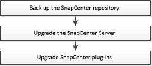

= SnapCenter 伺服器升級工作流程
:allow-uri-read: 
:icons: font
:imagesdir: ../media/

[role="lead"]
每個SnapCenter 版本的更新SnapCenter 版本均包含更新的更新版的《伺服器與外掛程式》套件。外掛程式套件更新會隨SnapCenter 更新程式一起發佈。您可以設定SnapCenter 使用此功能來檢查是否有可用的更新。

工作流程列出了升級SnapCenter伺服器和插件包必須完成的任務。

[[recommended-upgrade-path]]
== 建議升級途徑

NetApp 建議升級至最新支援的 SnapCenter 版本 6.2.3，以確保與 SnapCenter 的相容性與最佳效能。

CAUTION: 若要從 6.0 之前的版本或從 6.0 升級至 SnapCenter 6.2.3，請先升級至支援 .NET 8 和 Java 11 的 6.1P3，然後再升級至支援 .NET 10 和 Java 17 的 6.2.3。除非您已經在使用 6.2.2 或任何其他中間版本，否則請勿將其作為升級途徑的一部分。

有關升級主機的進一步詳細資料，請參閱 link:https://library.netapp.com/ecm/ecm_download_file/ECMLP3359467["SnapCenter 發行說明"^] 中的 *將主機升級至 SnapCenter 6.2.3*。

[[supported-upgrade-paths]]
=== 支援的升級途徑

本節顯示您可以從哪些SnapCenter版本升級以及支援哪些外掛程式版本。

NOTE: 如果將SnapCenter Server 升級至 6.2，也請將外掛程式升級至 6.2。

|===
| 如果您使用SnapCenter 的是伺服器版本... | 您可以直接將SnapCenter 伺服器升級至... | 支援的外掛程式版本 

.4+| 6.0.1. | 6.1  a| 
* 6.0.1.
* 6.1

| 6.2  a| 
* 6.2

| 6.2.1  a| 
* 6.2.1

| 6.2.2  a| 
* 6.2.2

.4+| 6.1  a| 
6.2
 a| 
* 6.1
* 6.2

| 6.2.1  a| 
* 6.2.1

| 6.2.2  a| 
* 6.2.2

| 6.2.3  a| 
* 6.2.2
* 6.2.3

.3+| 6.2 | 6.2.1  a| 
* 6.2

| 6.2.2  a| 
* 6.2

| 6.2.3  a| 
* 6.2.2
* 6.2.3

|===
請參閱 *將主機升級至 SnapCenter 6.2.3*（位於 link:https://library.netapp.com/ecm/ecm_download_file/ECMLP3359467["SnapCenter 發行說明"^] 中），以取得有關將主機升級至 SnapCenter 6.2.3 的進一步詳細資料。

若要了解如何升級SnapCenter Plug-in for VMware vSphere，請參閱 https://docs.netapp.com/us-en/sc-plugin-vmware-vsphere/scpivs44_upgrade.html["升級SnapCenter VMware vSphere的插件"^]。
